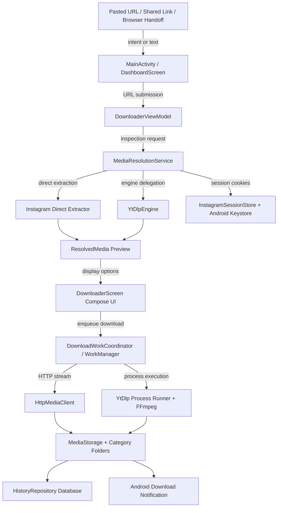

# Acqua - Developer Documentation

> Architecture, implementation notes, conventions, and verification guidance for Acqua development.

**Version:** 0.4.0 | **Last Updated:** 2026-10-19
**Scope:** Internal development, media downloader architecture, UI paradigms, testing, and release maintenance.

---

## Table of Contents

- [Architecture Overview](#architecture-overview)
- [Key Architectural Decisions](#key-architectural-decisions)
- [Technology Stack](#technology-stack)
- [Project Structure](#project-structure)
- [Runtime Flow](#runtime-flow)
- [Core Concepts](#core-concepts)
- [Navigation & State](#navigation--state)
- [Dual Download Engines](#dual-download-engines)
- [In-App Browser & Live Session Lifecycle](#in-app-browser--live-session-lifecycle)
- [Authenticated Sessions & Keystore Security](#authenticated-sessions--keystore-security)
- [Storage, Filename Formatter & History Database](#storage-filename-formatter--history-database)
- [UI & Design System](#ui--design-system)
- [Feature Deep Dive](#feature-deep-dive)
- [Naming Conventions](#naming-conventions)
- [Configuration](#configuration)
- [Security & Privacy Practices](#security--privacy-practices)
- [Error Handling](#error-handling)
- [Testing Suite](#testing-suite)
- [Build & Release Engineering](#build--release-engineering)
- [Intended Changes & Anomalies](#intended-changes--anomalies)
- [Project Auditing & Quality Standards](#project-auditing--quality-standards)
- [Website Architecture & Maintenance](#website-architecture--maintenance)
- [Troubleshooting](#troubleshooting)
- [Maintenance Notes](#maintenance-notes)
- [Feedback](#feedback)

---

## Architecture Overview

Acqua uses a modular MVVM architecture, unidirectional data flow (UDF), Kotlin Coroutines, StateFlow-backed UI state, and decoupled media extraction engines. The `:app` module owns composition and navigation, features own their state and UI, and core modules own shared domain, data, and presentation infrastructure.



---

## Key Architectural Decisions

| Decision | Rationale |
| :--- | :--- |
| **Decoupled Dual Engines** | Acqua provides a native fast-path extractor for direct carousel and photo posts alongside a full-featured `yt-dlp` runtime for complex video, audio extraction, format conversion, and metadata embedding. |
| **Persistent In-App Browser** | The browser runs in a dedicated full-screen overlay above the main dashboard. Downloading from a live page or returning preserves navigation history, active sessions, and DOM state without reload overhead. |
| **Keystore Session Security** | Saved transfer snapshots are encrypted at rest using AES-256-GCM keys managed by Android Keystore; live browser storage remains WebView-owned app-private data. |
| **Material 3 Expressive System** | Settings use grouped surfaces with wrapping descriptions; shared list items use `expressiveSegmentedShapes` for joined outer/inner corners. |
| **Composite Build-Logic Verification** | Enforces strict release metadata checks, production string validation, and version catalog freshness via an isolated Gradle build-logic convention plugin. |
| **Zero Telemetry by Design** | No analytics, ad SDKs, or remote tracking libraries are included. Networking serves media/browser requests, optional segment removal, configured engine updates, and GitHub release feeds/updates. |
| **Categorized Media Bucketing** | Automatically routes downloaded files into organized `Images/`, `Videos/`, and `Audio/` subfolders based on verified MIME types. |
| **Searchable Local History Store** | Persists source metadata and file references locally for search, sharing, relinking, and download recovery. |

---

## Technology Stack

| Area | Technology |
| :--- | :--- |
| **Language & Toolchain** | Kotlin 2.4.20, Java 21 Gradle daemon, JVM 11 bytecode target, Gradle 9.8.0, Android Gradle Plugin 9.4.1 |
| **Android Platform** | compileSdk/targetSdk 37, minSdk 24 (Android 7.0+), AndroidX Core KTX, Activity Compose, Lifecycle Runtime |
| **UI & Styling** | Jetpack Compose BOM 2026.09.00, Material 3 1.5.0-alpha29, Material 3 Adaptive 1.3.0, Material Icons Extended |
| **Networking & HTTP** | OkHttp 5.5.0, Kotlin Coroutines, Flow |
| **Media Extraction & Processing** | youtubedl-android, yt-dlp, FFmpeg native runtimes, QuickJS-Android, Python runtime |
| **Security & Storage** | Android Keystore (AES-GCM), SharedPreferences/DataStore, Storage Access Framework |
| **Testing** | JUnit 4, AndroidX Test, Robolectric, Kotlinx Coroutines Test, Turbine |

Versions are centralized in [`acqua-app/gradle/libs.versions.toml`](acqua-app/gradle/libs.versions.toml).

---

## Project Structure

```text
acqua/
├── assets/                                      # Repository branding and SVG logos
├── docs/                                        # Static project documentation website
│   ├── index.html                               # Landing page, live GitHub counters, Bento grid, Credits, FAQ
│   ├── styles.css                               # Responsive styling, typography, mobile viewport fixes
│   ├── boot.js                                  # Early progressive-enhancement marker
│   ├── scripts.js                               # Navigation, FAQ, reveals, and cached GitHub statistics
│   └── assets/                                  # Project artwork; icons are also embedded as SVG
├── acqua-app/
│   ├── build-logic/                             # Convention plugins and verification tasks
│   │   └── src/main/kotlin/
│   │       └── AcquaAndroidApplicationConventionsPlugin.kt
│   ├── gradle/
│   │   └── libs.versions.toml                   # Centralized version catalog
│   ├── app/                                     # Application graph, activities, navigation, About UI
│   ├── core/
│   │   ├── domain/                              # Pure Kotlin links, media, resolver contracts and failures
│   │   ├── data/                                # Persistence, network, storage, resolvers and download execution
│   │   └── ui/                                  # Shared Compose theme, components, image and security UI
│   └── feature/
│       ├── downloads/                           # Downloader, queue and History presentation
│       ├── browser/                             # Browser, saved websites and bookmark metadata
│       ├── settings/                            # Preferences, backup/restore and yt-dlp maintenance
│       ├── updates/                             # Tracked repositories and app update presentation
│       └── onboarding/                          # First-run and restore workflow
├── CHANGELOG.md                                 # User-visible version changelog
├── DEVELOPMENT.md                               # Architecture & development guide (This Document)
├── LICENSE.md                                   # GNU General Public License v3 or later
├── PRIVACY.md                                   # User-facing privacy policy
├── TASKS.md                                     # Prioritized task queue
└── THIRD_PARTY_NOTICES.md                       # Runtime component licensing and credits
```

---

## Runtime Flow

1. **Launch & URL Ingestion:** `MainActivity` handles shared `ACTION_SEND` text; `QuickDownloadActivity` validates external HTTP(S) `ACTION_VIEW` links. Accepted links enter the downloader for configuration and inspection.
2. **Pre-Resolution & Inspection:** When Fetch is requested, `MediaResolutionService` dispatches to direct, Instagram, browser-assisted, or yt-dlp resolution. It extracts available metadata, thumbnails, resolutions, and audio streams without saving full media files.
3. **Configuration & Options:** The user reviews preview cards in `DownloaderScreen`. Quality options (e.g. 1080p vs 720p, Original vs MP3, metadata embed) are selected via the options sheet.
4. **Queueing & Background Work:** Tapping **Download** sends the request through `DownloadWorkCoordinator` to WorkManager or an Android 14+ user-initiated data-transfer job. Both share one execution slot by default, with an optional second slot, persistent notification progress, and independent cancellation.
5. **Validation & Finalization:** `DownloadExecutor` verifies and processes the outputs, applies accepted naming rules, and asks `MediaStorage` to publish to default Downloads storage or the chosen media-type folder.
6. **Notification & History Indexing:** Completion provides file-opening/sharing actions. The provider-visible result is indexed in `HistoryRepository` when Save to History is enabled.

`AcquaApp` reads onboarding state before foreground engine maintenance. Automatic
checks are skipped while setup is incomplete and resume on subsequent foreground
entries after completion. First-run migration ignores engine-update timestamps and
cached versions; user preferences and package upgrade timestamps still identify
existing installations.

---

## Core Concepts

### Download Engines

- **Acqua Direct Extractor:** Fast, zero-overhead HTTP client tailored for direct media links and multi-item carousels.
- **yt-dlp Engine:** Python-based extraction runtime capable of stream demuxing, video/audio transcoding, chapter marking, and cover artwork injection.
- **Engine Selection:** Choose Acqua or yt-dlp on the download bar; browser-assisted extraction and session recovery use explicit controls.

### Filename Templating Engine

Acqua supports customizable filename formatting via `FilenameFormatter`:

| Variable | Description | Example |
| :--- | :--- | :--- |
| `{title}` | Title of the media item | `Scenic Sunset` |
| `{username}`, `{artist}`, `{album}` | Available uploader, artist, and album details | `nature_captures` |
| `{resolution}` | Width and height when known | `1080x1920` |
| `{date}`, `{time}` | Current local date and time | `20261019`, `143000` |
| `{index}` | One-based position when saving multiple items | `2` |
| `{source_id}`, `{extractor}` | Source identity and extractor | `C_4x9LmZ1`, `Youtube` |
| `{collection}`, `{collection_index}`, `{collection_count}` | Collection title, position, and size | `Playlist`, `2`, `10` |
| `{chapter}` | Clip or chapter title | `Introduction` |
| `{upload_date}` | Original source date in UTC | `20260830` |

Extensions are added automatically. `{token|fallback}` supplies missing values;
`{{` and `}}` produce literal braces. Unknown tokens remain literal, metadata is
not evaluated as an expression, and unsafe path characters become underscores.
An explicit task name takes precedence. Chapter outputs append their chapter
title when the template omits it. Empty results fall back to title, artist,
uploader, or a dated name. Final names are bounded to 240 UTF-8 bytes, including
caption/artwork suffixes, extensions, and collision numbers.

### Accepted Requests And Concurrency

`DownloadRequestStore` keeps accepted options, filenames, destinations, network
settings, chapter catalogs, and session authorizations outside scheduler extras.
Schedulers carry only the request identity. Retry publication checkpoints reuse
accessible completed outputs and publish the remaining artifacts. Preference
changes affect new work. Terminal task records retain at most 200 entries for
30 days, independently of scheduler cleanup.

`DownloadExecutionGate` shares a FIFO bound of one or two whole downloads across
both scheduling backends. Cancellation and failures release slots; lowering the
bound lets active work finish before admitting more. Fragment concurrency is
separate. Matching duplicate-skipping requests wait for the first publication
before checking its saved result. Progress, notifications, and cancellation stay
independent per task.

### Collections, Streams, Clips, And Captions

Nested collections are flattened for display while retaining each leaf's source
URL and local playlist position. Unavailable entries remain visible. Inspection
is bounded to eight nested levels, 2,000 visited entries, and 16 linked sources;
duplicate addresses reuse results and cycles remain unavailable. Selection
indices refer to the displayed list, not positions in an outer playlist.

Exact stream selections retain codec, resolution, frame rate, language, channel,
and bitrate signatures without saving stream URLs. Expired or unavailable streams
allow one detailed reinspection with accepted network/session settings. Recovery
requires the same source and equivalent, unambiguous streams. Multiple audio
tracks use MKV; silent video requires a video-only source and clears audio and
combined-stream choices. Audio-only downloads select one source audio stream.

`MediaTimelineProcessor` downloads the source once, then makes up to 20 ordered,
nonoverlapping named clips, at least 1 ms long, or up to 200 inspected chapters.
Video cuts use H.264, or VP9 for WebM; audio is copied at packet boundaries.
Temporary storage must accommodate the source, intermediate files, and outputs.
Caption timing applies scale (0.5 to 2.0), then offset (-3600 to 3600 seconds),
then intersects and rebases cues to each clip. Chapters are rebased similarly
when metadata is enabled. Segment removal cannot be combined with these timeline
edits.

Timeline edits use SRT intermediates limited to 2 MiB and 20,000 cues. Original
caption format becomes SRT during editing. Separate output supports SRT, VTT,
ASS, and LRC; audio embedding requires M4A, ASS embedding requires MKV video,
WebM embedding uses VTT, and LRC stays separate. Clips with no remaining cues
omit captions; missing or malformed requested inputs fail before publication.
Accepted ranges, timing, fractional durations, and chapter catalogs survive
restart/retry. New links clear source-specific selections. Dialog drafts apply
only on Done.

### Transfer Network Options

Inspection uses current defaults; per-download overrides apply to accepted
transfers and separate artwork. Direct requests support speed limits, HTTP or
SOCKS5 proxies, and IPv4-only connections. yt-dlp supports proxy/IPv4 inspection,
download speed limits, and 1 to 8 concurrent fragments. Speed is per transfer
or fragment, not a shared total; zero means unlimited.

Proxy addresses require `http://host:port` or `socks5://host:port` without
credentials, paths, queries, or fragments. Empty keeps system proxy policy;
configured failures do not fall back to direct requests. IPv4-only rejects SOCKS
routes because remote DNS cannot enforce the policy. These controls do not
affect browser navigation, site-specific extraction, Feeds, or updater requests.

### Command Templates

Settings stores up to 20 validated yt-dlp option templates. Applying one fills
download controls; later edits take precedence, and choosing quality or exact
streams clears the raw format selector. New links clear template bindings.
Editing or deleting a selected template requires reselection for new requests;
accepted work retains its resolved snapshot through restart and retry.

`CommandTemplateParser` accepts these options and the implemented `--no-` forms:

- `-f`/`--format`: one selector with fallbacks, filters, and merged streams;
  comma-separated outputs, `all`, regex filters, and URLs are rejected.
- `-S`/`--format-sort`: validated comma-separated sort fields.
- `-x`, `--audio-format` (`best`, `original`, `m4a`, `mp3`), and
  `--audio-quality` (`0` or `32K` through `512K`).
- `--remux-video`/`--merge-output-format` (`mp4`, `mkv`, `webm`),
  `--audio-multistreams`, metadata, embed/write thumbnail, and mtime options.
- Write/embed/automatic subtitles, `--sub-langs`, and `--convert-subs`.
- Chapter splitting, supported SponsorBlock categories, IPv4, fragment counts,
  and `-r`/`--limit-rate` (K/M or integral KiB expressed as bytes).

Templates are option text, optionally prefixed with `yt-dlp`, with quoted words
and backslash escapes. Shell execution, credentials, headers, cookie/config
files, arbitrary output paths, and custom postprocessors are rejected. Raw
selectors must produce one media output. Imports preview before applying and
never start downloads. Limits are 4 KiB, 128 words, and 512 characters per word;
documents are limited to 256 KiB. JSON uses kind `acqua.command-templates`,
version `1`, and a `templates` array of UUID `id`, `name`, and `command` fields.
Matching IDs update entries; duplicate names and invalid documents fail without
changing originals. Exports are unencrypted and redact sensitive name patterns.

---

## Navigation & State

Acqua uses `MainActivity` for the dashboard plus internal `BrowserActivity`,
`DownloadActivity`, and `RenderedPageResolverActivity` entry points. Exported
`QuickDownloadActivity` validates external HTTP(S) views. `AcquaApp` owns the
application-scoped dependency graph and custom WorkManager factory.

- **Main destinations:** Downloads, Browser, and Feeds, with adaptive bottom or rail navigation.
- **Download hub:** Downloader and History share the Downloads destination.
- **Settings and information:** Settings opens from the header; About, notices, and legal documents use nested overlays with back-handler integration.

---

## Dual Download Engines

Acqua encapsulates its extraction strategies behind `MediaResolutionGateway` and `MediaResolutionService`:

1. **Inspection Phase:** Inspects URL patterns to select the optimal extractor.
2. **Session Injection:** If authenticated browser sessions are enabled, matching cookies for the target host are securely injected.
3. **Execution Routing:**
   - Single direct URLs run over pure OkHttp coroutine streams.
   - Complex multi-format or conversion requests run through `YtDlpEngine`, streaming output logs for progress parsing.
4. **Failure Recovery:** If direct extraction fails with restricted content, Acqua prompts the user to open the link in the built-in browser to authenticate.

---

## In-App Browser & Live Session Lifecycle

- **Persistent Surface:** The browser activity runs above the dashboard stack. Opening a download from a page does not destroy or reload the browser.
- **Browser Controls:** The address bar and navigation controls provide back, forward, reload/stop, page download, and return actions.
- **Bookmark Management:** Bookmarks save custom titles, URLs, and favicons, supporting touch-and-hold editing and fast one-tap navigation.

---

## Authenticated Sessions & Keystore Security

- **Credential Isolation:** Login happens strictly within Android WebView. Acqua never requests or captures user passwords.
- **Keystore Encryption:** Saved cookie snapshots used for background extraction are encrypted using AES-256-GCM keys managed by Android Keystore.
- **Granular Data Management:** Supported WebViews clear a parent website and its subdomains. Older WebViews disclose an all-cookie fallback while retaining unrelated bookmarks. Clearing all browser data also clears saved sessions and disables browser-session use. Privacy disclosures are maintained in [PRIVACY.md](PRIVACY.md#browser-sessions).

### Named Browser Sessions

`BrowserCookieCapture` saves up to 20 uniquely named snapshots after an explicit
website authorization. Captures retain the observed user agent and up to 200
cookies within 256 KiB. Available domain, path, expiry, Secure, and HttpOnly
attributes govern transfers. SameSite is retained for export without emulating
browser navigation; partitioned cookies are excluded from standalone transfers.
Older WebViews expose only names/values, so captures use the observed host/path,
HTTPS where observed, and a local 24-hour limit.

Choose a session before inspection. Changing it clears source-specific metadata,
streams, and clips; refreshed snapshots must be reselected for new work. Named
inspection/transfers do not fall back to the live browser or another account.
The browser keeps one shared sign-in context. The direct engine accepts
authenticated files; supported webpages use yt-dlp.

`CookieProfileStore` encrypts profiles and accepted authorizations with Android
Keystore. Identical accepted snapshots share one encrypted copy. Refresh retains
already accepted snapshots; removal deletes their authorizations and blocks
queued retries. Unreferenced snapshots have a 24-hour cleanup grace period.
Native cookie files are private, unique per operation, and cleaned after use or
process restart. Explicit session export writes unencrypted version-1
`acqua.cookie-profile` JSON with cookies, attributes, capture URL/time, and user
agent; it rejects a snapshot changed during the picker. Profile import is not
offered. Normal settings and History exports exclude these credentials.

---

## Storage, Filename Formatter & History Database

### Category Subfolder Bucketing
With the default destination and **Organize into media folders** enabled:
- Images are saved to `Downloads/<Subfolder>/Images/`
- Videos are saved to `Downloads/<Subfolder>/Videos/`
- Audio tracks are saved to `Downloads/<Subfolder>/Audio/`

### Download History Store
- Uses a local SQLite database retaining file references, size, source URL, title, author, source identity/host, media type, and completion timestamp. History thumbnails come from local files; remote thumbnail URLs are not retained.
- Detects deleted or moved files in shared storage and provides a **Download again** action.

### Custom Download Folders

Photos, audio, and video can each use a writable Android document-tree destination
with retained read/write grants. Custom destinations use the selected folder
directly; captions and artwork follow their owning media. Optional website and
collection subfolders have sanitized names bounded to 80 UTF-8 bytes. Restoring
settings does not recreate grants on another installation. Folder providers
control timestamps and availability.

Gallery hiding creates an `Acqua hidden` child with an exact `.nomedia` marker.
It affects future outputs, does not move old files, and does not provide access
protection. Publication creates a new document, preserves collisions, and uses
provider-assigned names in History. Directory scans are bounded to 10,000
children. Missing/revoked grants and failed copies stop publication instead of
changing destinations. Direct transfers stage privately. Failed copies,
cancellation, and failed History insertion remove new documents; failed cleanup
is retried after restart. Completed copies can survive a crash around History
insertion without a History record. Legacy filename reservation is atomic.

### History Interchange

History exports selected/all records as JSON or unique source URLs. Limits are
2,000 records and 1 MiB of UTF-8 text, or 256 KiB through the clipboard. Export
reads a consistent database snapshot. Import previews duplicates and unavailable
files, rechecks before applying, preserves existing records, and rejects an
invalid document as a whole. It neither starts downloads nor transfers files or
Android grants. Legacy `file:` references remain unavailable. Document-picker
relinking retains a read grant; unavailable records can be kept, converted to
links, or skipped. Private cached drafts last up to 24 hours and are removed on
apply, explicit Cancel, or later expired-draft cleanup.

Version-1 History JSON has this shape; title, author, and source identity are
optional:

```json
{"kind":"acqua.history","version":1,"entries":[{
  "id":"stable-record-id","timestamp":1792281600000,
  "url":"https://example.com/source","fileName":"Example.mp4",
  "fileUri":"content://provider/document/example","isVideo":true,
  "mimeType":"video/mp4","sizeBytes":123,"isDownloaded":true,
  "title":"Example","author":"Author","sourceIdentity":"source-id"
}]}
```

The version-1 `acqua.library` adapter uses `sourceUrl`/`uri` instead of
`url`/`fileUri`, derives video status from MIME type, omits `isDownloaded`, and
allows deterministic IDs when `id` is absent. Other fields have the same meaning.
History also accepts validated `acqua.command-templates` documents through their
own preview, which updates templates without adding History records. It does
not infer arbitrary third-party formats.

---

## UI & Design System

Acqua implements **Material 3 Expressive** design tokens and grouped list presentation:

### 1. Shape Tokens (`ui/theme/Shape.kt`)
- `ExpressiveShapes`: Semantic corner scales (`extraSmall = 4.dp`, `small = 8.dp`, `medium = 16.dp`, `large = 24.dp`, `extraLarge = 28.dp`).
- `expressiveSegmentedShapes(index, count)`: Computes 28dp outer corners and 4dp inner segment corners for joined list items.

### 2. Spacing Tokens (`ui/theme/Spacing.kt`)
- `LocalSpacing` provides centralized coordinates (`screenGutter = 16.dp`, `cardPadding = 16.dp`, `segmentedGap = 2.dp`).

### 3. Grouped UI Primitives (`ui/components/`)
- `SettingsSection`: Semantic bold section header with 2dp item gaps.
- `SettingsSwitchRow`: Full-row toggle with merged switch semantics (`Role.Switch`) and wrapping text.
- `SettingsActionRow`: Full-row action with optional leading/trailing icons and wrapping descriptions.
- `SettingsCardContainer`: Grouped surface with 24dp outer and 4dp inner corners.

### Accessibility And App Languages

High contrast adjusts app surfaces, accents, category/status colors, and outlines
after theme selection while retaining the saved theme. Media and website colors
remain unchanged. Automated checks target 7:1 text-role contrast, 4.5:1 outlines,
and 3:1 category icons; disabled-content blends are measured separately.

Language choices are System default, English, Spanish, Hindi, and Arabic, with
English fallback for untranslated text. Android 13+ uses platform app locales;
earlier versions wrap activity/application contexts and migrate the saved choice
once without overriding an existing platform choice. Starter translations still
need human wording, plural, RTL, and screen-reader review on physical devices.

---

## Feature Deep Dive

### 1. Downloader (`feature/downloads`)
- Owns URL input parsing, preview cards, quality sheet, and active download progress.
- `QuickDownloadActivity` accepts HTTP(S) website/media `ACTION_VIEW` links with supported image, video, audio, HTML, binary, HLS, or DASH types. It validates host/port and an 8192-character bound, rejects credentials/whitespace, and ignores resolved-media/session extras. Configuration requires explicit Fetch and Download actions; setup-incomplete links pass to onboarding. A new link clears old permission actions; repeated links do not resubmit work. Local file/content views and APK installation use other entry points.

### 2. Browser (`feature/browser`)
- Owns WebView container, bookmark manager, floating action pill, and cookie session extraction.

### 3. History (`feature/downloads`, `history` package)
- Owns search/source filtering, media/photo/video/audio/link/unavailable categories, sharing, record removal/Undo, confirmed file deletion, import/export, and relinking.

### 4. Settings (`feature/settings`)
- Owns destination and filename defaults, media/network policies, sessions/templates, concurrency, diagnostics, appearance/language, backups, engine maintenance, and WebView provider diagnostics.

### 5. About (`app`, `feature/about` package)
- Owns app information, device diagnostics, version copy action, privacy policy, and open-source licenses catalog.

### 6. Feeds (`feature/updates`)
- Tracks GitHub APK releases, installed-app matches, asset selection, downloads/installation, credentials, and feed import/export. Feed credentials are separate from browser sessions.

---

## Naming Conventions

### Directory & File Names
- **Compose Screens:** PascalCase with `Screen` suffix (e.g. `SettingsScreen.kt`).
- **Composables:** PascalCase without suffix (e.g. `SettingsSection.kt`).
- **ViewModels:** PascalCase with `ViewModel` suffix (e.g. `DownloaderViewModel.kt`).
- **Repositories & Stores:** PascalCase with `Repository` or `Store` suffix (e.g. `AppSettingsRepository.kt`).

### Method Signatures

| Prefix | Intent | Example |
| :--- | :--- | :--- |
| `load` | Read state / data | `loadHistory()` |
| `set` | Update preference value | `setBaseFolder(folder)` |
| `on` | Event callbacks | `onOpenAbout` |
| `toggle` | Flip boolean state | `toggleFilenameVariable(var)` |
| `clear` | Reset stored data | `clearHistory()` |
| `update` | Modify state or dependency | `updateYtDlp()` |
| `format` | Convert data for display | `formatFileSize(bytes)` |
| `is` / `has` | Boolean checks | `isUpdatingYtDlp()` |

---

## Configuration

### Compilation Metrics

| Attribute | Configuration Value |
| :--- | :--- |
| **Namespace** | `dev.qtremors.acqua` |
| **Compile SDK** | 37 |
| **Target SDK** | 37 |
| **Min SDK** | 24 (Android 7.0+) |
| **Version Code** | 40 |
| **Version Name** | 0.4.0 |
| **Java Target** | JVM 11 |
| **Gradle Version** | 9.8.0 |
| **Gradle JVM** | JDK 21 |
| **Kotlin Version** | 2.4.20 |
| **AGP Version** | 9.4.1 |
| **Compose BOM** | 2026.09.00 |

### Manifest Permissions

```xml
<uses-permission android:name="android.permission.INTERNET" />
<uses-permission android:name="android.permission.ACCESS_NETWORK_STATE" />
<uses-permission android:name="android.permission.POST_NOTIFICATIONS" />
<uses-permission android:name="android.permission.FOREGROUND_SERVICE" />
<uses-permission android:name="android.permission.FOREGROUND_SERVICE_DATA_SYNC" />
<uses-permission android:name="android.permission.FOREGROUND_SERVICE_MEDIA_PROCESSING" />
<uses-permission android:name="android.permission.RUN_USER_INITIATED_JOBS" />
<uses-permission android:name="android.permission.REQUEST_INSTALL_PACKAGES" />
<uses-permission android:name="android.permission.VIBRATE" />
<uses-permission android:name="android.permission.WRITE_EXTERNAL_STORAGE" android:maxSdkVersion="28" />
```

---

## Security & Privacy Practices

1. **Keystore Protection:** Saved transfer cookies are encrypted with AES-256-GCM via Android Keystore. Hardware backing depends on the device.
2. **Credential Isolation:** Browser passwords are not captured by Acqua; named session snapshots and GitHub tokens use Keystore encryption. Explicit cookie exports contain unencrypted sign-in credentials and require disclosure and a chosen document location.
3. **Scoped Network Access:** Media/browser requests, optional SponsorBlock requests, configured engine maintenance, Feeds, and app updates contact their respective services. Requests and credential boundaries are documented in [PRIVACY.md](PRIVACY.md).
4. **No Telemetry:** Acqua contains zero analytics, ad SDKs, or user tracking services.
5. **Local Storage Cleanup:** Users can wipe all browser data, cookies, and cache at any time.

---

## Error Handling

- **ViewModels:** Map repository and engine exceptions to typed UI state such as `DownloaderProblem`, `MediaResolutionFailure`, and `DownloadFailure`.
- **Network Resilience:** Automatic retry on transient network failures.
- **Cancellation Safety:** Coroutine flows catch and rethrow `CancellationException` to ensure proper job cancellation.

---

## Testing Suite

Acqua uses module-owned JVM tests, AndroidX instrumentation and Compose tests, Robolectric, WorkManager test helpers, MockWebServer, kotlinx-coroutines-test, Turbine, architecture rules, and build-logic verification gates.

### Verification Commands

Run commands from `acqua-app`. Prefer focused tests for the changed area and run
Gradle serially with `--no-parallel --max-workers=1` on constrained machines.

```bash
# Run all unit tests:
./gradlew testDebugUnitTest

# Validate production string assets (checks for non-resource text):
./gradlew checkProductionStrings

# Verify build conventions and release metadata:
./gradlew :app:verifyAcquaBuildConventions

# Compile instrumentation APKs without a device:
./gradlew assembleDebugAndroidTest

# Complete unsigned local release verification gate:
./gradlew verifyLocalRelease
```

### Local UI And Media Fixtures

With JDK 21 and cached Android/Robolectric dependencies, run the focused Windows
workflow runner:

```powershell
./tools/verify_ui_workflows.ps1
```

It uses offline Gradle, one worker, Robolectric API 35, Compose semantics/native
graphics, fake queues/resolution, shadow WebViews, and loopback storage providers.
Coverage includes download/configuration/progress, permission denial/recovery,
navigation, browser handoff, sharing, History actions, folder failures, keyboard
focus, and draft/selection restoration. Layout checks include compact/expanded
screens, themes/high contrast, RTL, and large text. The runner also performs
Kotlin source analysis. It does not establish real-device behavior.

Host media fixtures require Python, FFmpeg, and ffprobe on PATH. Install the
pinned host dependency into the ignored build directory, then select a suite:

```powershell
python -m pip install --no-deps --target build/host-python yt-dlp==2026.8.19
python tools/verify_media_fixtures.py segments
python tools/verify_media_fixtures.py formats
python tools/verify_media_fixtures.py captions
python tools/verify_media_fixtures.py streams
python tools/verify_media_fixtures.py templates
python tools/verify_translations.py
```

These disposable generated-media/loopback fixtures check segment cuts, format
selection, caption conversion/embedding, multi-audio and silent streams, template
outputs, and durations without contacting media websites or SponsorBlock.
Translation checks validate resource keys, placeholders, plural forms, and
English fallback.

The timeline and cookie suites first need fixture plans written by focused JVM
tests using production code:

```powershell
./gradlew.bat :core:data:testDebugUnitTest --tests '*MediaTimelineTest' --tests '*CookieProfileTest' --offline --no-parallel --max-workers=1
python tools/verify_media_fixtures.py timelines
python tools/verify_media_fixtures.py cookies
```

Timeline fixtures execute generated FFmpeg arguments and edited caption/chapter
files for named clips, chapter splits, caption timing, M4A, ASS, and LRC. Cookie
fixtures use generated Netscape rows and a captured user agent to check matching
requests and path-changing/cross-host redirects. Host processing does not prove
Android native runtime, Keystore, WebView, provider, playback, or physical-device
compatibility. Real-device lifecycle, storage-provider, account/session,
accessibility, and playback checks remain separate acceptance work.

---

## Build & Release Engineering

### Build Commands

```bash
# Build universal and ABI-specific debug APKs:
./gradlew :app:assembleDebug

# Build minified release APKs:
./gradlew :app:assembleRelease
```

On Windows, use `gradlew.bat`.

### Output Artifacts

| Variant / ABI | Release Output Path | Purpose |
| :--- | :--- | :--- |
| Universal | `app/build/outputs/apk/release/Acqua-<version>.apk` | Bundles all four native architectures |
| `arm64-v8a` | `app/build/outputs/apk/release/Acqua-<version>-arm64-v8a.apk` | 64-bit modern ARM devices |
| `armeabi-v7a` | `app/build/outputs/apk/release/Acqua-<version>-armeabi-v7a.apk` | 32-bit legacy ARM devices |
| `x86_64` | `app/build/outputs/apk/release/Acqua-<version>-x86_64.apk` | 64-bit emulators and Intel devices |
| `x86` | `app/build/outputs/apk/release/Acqua-<version>-x86.apk` | 32-bit emulators |

### Release Signing

Configure `acqua-app/signing.properties` (or `local.properties`):

```properties
signing.storeFile=/absolute/path/to/acqua-release.jks
signing.storePassword=your_store_password
signing.keyAlias=your_key_alias
signing.keyPassword=your_key_password
```

Verify the signed release APK:

```bash
apksigner verify --verbose --print-certs app/build/outputs/apk/release/Acqua-<version>-arm64-v8a.apk
```

---

## Intended Changes & Anomalies

| Aspect | Custom Implementation | Design Rationale |
| :--- | :--- | :--- |
| **Separate Application IDs** | `dev.qtremors.acqua.debug` for Debug, `dev.qtremors.acqua` for Release. | Allows side-by-side installation without data or session collision. |
| **Persistent Browser Layer** | Browser activity runs in an overlay above the main dashboard. | Preserves active WebView DOM state and cookies during downloads. |
| **Decoupled Dual Extractor** | Fast direct HTTP client + yt-dlp runtime. | Maximizes download speed for simple posts while retaining support for complex media. |

---

## Project Auditing & Quality Standards

When reviewing code changes, ensure:
1. **Resource Strings:** All user-facing strings must be localized in `strings.xml` to pass `checkProductionStrings`.
2. **Convention Adherence:** Build configuration and version catalog must pass `:app:verifyAcquaBuildConventions`.
3. **Design Consistency:** Use shared Settings rows and grouped list primitives, with wrapping text and appropriate semantics.
4. **Memory Safety:** Image previews in carousels must be bounded in temporary storage and decoded at screen size.
5. **Zero Telemetry:** No analytics or tracking code may be introduced.

---

## Website Architecture & Maintenance

The public website is a dependency-free static site under `docs/` and is served from semantic HTML, responsive CSS, local assets, and small progressive-enhancement scripts.

### Site Structure

- **`index.html`:** Owns metadata, navigation, landing-page content, feature cards, privacy information, credits, FAQ markup, and download links.
- **`styles.css`:** Owns responsive layout, system typography, focus treatment, mobile navigation, dark presentation, and reduced-motion behavior.
- **`boot.js`:** Adds the early JavaScript marker used to progressively enhance content without making the base page depend on scripts.
- **`scripts.js`:** Owns mobile navigation focus, FAQ state, reveal effects, animated counters, and GitHub repository/release statistics.
- **`assets/`:** Contains local project artwork. Typography uses system fonts; interface icons are inline SVG.

### GitHub API Integration

`scripts.js` reads public repository and release endpoints only. It caches successful counts in local storage, uses ETags and a time-to-live to reduce requests, follows bounded release pagination, preserves cached values during rate limits or network failures, and accepts release links only under the Acqua GitHub release path. The page remains readable and navigable when JavaScript or the GitHub API is unavailable.

### Content And Styling Guidelines

- Keep supported-source, media-format, Android-version, and APK-architecture claims aligned with `README.md` and the implemented app behavior.
- Preserve semantic HTML and keyboard behavior before adding ARIA attributes or scripted interaction.
- Keep required assets local, retain the restrictive content security policy, and use the existing design tokens and responsive breakpoints in `styles.css`.
- Update `index.html`, `README.md`, and this guide together when a public capability changes.
- Run `./gradlew verifyStaticSite` from `acqua-app/` after content, link, style, script, or asset changes.

---

## Troubleshooting

- **yt-dlp extraction fails:** Tap **Update yt-dlp now** in Settings to download the latest extractor definition.
- **WebView provider unavailable:** Ensure Android System WebView is updated via Google Play or system settings.
- **Download notification missing:** Ensure notification permission is granted on Android 13+ devices.
- **Build toolchain issues:** Ensure JDK 21+ and Android SDK 37 are configured in your local environment.
- **Gradle dependency verification:** Disabled project-wide with `org.gradle.dependency.verification=off` in `acqua-app/gradle.properties`. Dependency upgrades and IDE source downloads do not require checksum-list updates. The historical verification metadata is retained but is not enforced.

---

## Maintenance Notes

- **Changelogs:** Update `CHANGELOG.md` under the current version header for every user-visible change.
- **Version Bumps:** Do not bump versions unless explicitly instructed. Keep project and build versions identical (`1.2.3` → code `123`).
- **Release Verification:** Always run `verifyLocalRelease` before declaring an unsigned release candidate ready. Run connected instrumentation tests separately on the required device matrix.

---

## Feedback

Acqua is a solo open-source project. Forking for personal use is welcome under the GNU GPLv3+ license terms.

To report bugs, request features, or suggest improvements, please open an issue on the [GitHub issue tracker](https://github.com/qtremors/acqua/issues).

---

<p align="center">
  <a href="README.md">Back to README</a>
</p>
